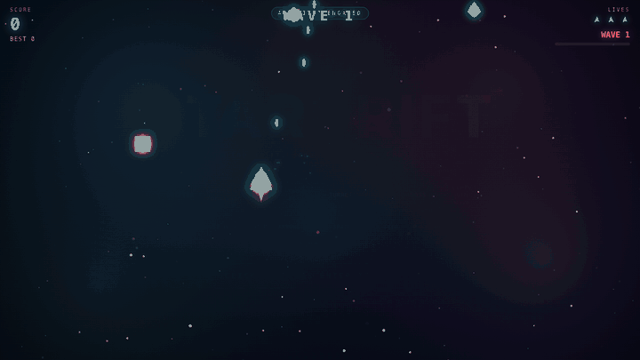

# Condor

Qwen3.8-Flash-Next (180B, MoE) on one 12-16 GB NVIDIA GPU with 32-64 GB of RAM, on Linux or Windows. Our own engine and our own
compressed weights. OpenAI- and Anthropic-compatible APIs, a chat page, MCP. Free for personal use. More Flash-class models will come here.



The model wrote that game in one prompt on my 4080 SUPER, unedited. 3 of 6 tries were playable in precise mode; all 6 are in
[examples/star-drift](examples/star-drift), broken ones included.

**v0.2.4** (2026-10-21): precise and best are closer to the original (KL vs bf16 0.22 -> 0.15 and 0.165 -> 0.12; new downloads
`precise-v2/` and `best-v2/`, `./setup.sh` fetches them), long prompts are read faster (fast: a 4K prompt's first token 1.7 -> 1.3 s),
and a named `tool_choice` gets one call. Details in the [CHANGELOG](CHANGELOG.md).

## How it works, in short

- The engine knows which experts the model routes to. The busy ones sit on the GPU, the rest in RAM; the CPU computes the misses while
  the GPU works on the layer.
- Experts are compressed by use: busy ones keep more bits.
- The model's own draft head guesses the next token and the big model checks it in the same pass.
- Long prompts go through the model a layer at a time, so a 32K prompt doesn't blow up memory.

Details: [docs/HOW_IT_WORKS.md](docs/HOW_IT_WORKS.md).

## Numbers

RTX 4080 SUPER 16 GB, Ryzen 9 7950X3D, 64 GB RAM, Ubuntu 26.04. Greedy, thinking off, `bench/compare.py`.

```
                                     precise             best                fast
experts, avg bits/weight             ~2.9                ~3.4                ~2.0
attention + rest                     6 bit               6 bit               4-5 bit
download                             82 GB               90 GB               66 GB
KL divergence vs bf16 (wikitext-2)   0.15                0.12                0.39

first token, short / 4K / 30K        0.26 / 1.9 / 7.3 s  0.33 / 2.1 / 7.4 s  0.16 / 1.3 / 7.5 s
writing, short / 4K / 30K prompt     91 / 86 / 91        79 / 71 / 76        113 / 115 / 131 tok/s

GSM8K   (150 q, Inspect AI)          148/150             147/150             149/150
MMLU-Pro (150 q, Inspect AI)         127/150             131/150             121/150
```

Speed: v0.2.4's build, 2026-10-21, the median of three runs each, nothing else on the computer. GSM8K and MMLU-Pro: precise and best
on that build the same night, fast on 2026-10-19 (its experts are unchanged). Run to run, writing speed moves about 5-10% here (fast
measured 124 tok/s on a short prompt on 2026-10-19). GSM8K is a sanity check that compression didn't break reasoning; MMLU-Pro says
more. Logs in [results/](results), scripts in [bench/](bench). Also tested on a cloud A10 (24 GB) and, on Windows, an L4 (24 GB).

Your own machine: `tools/bench.sh` (about 5 min) prints a block to paste into a "Bench result" issue. To compare with what you run now,
`bench/compare.py` runs the same prompts and questions against any OpenAI-compatible server ([bench/README.md](bench/README.md)); I
don't publish comparisons myself.

## What you need

- NVIDIA RTX 30/40/50 (or an Ampere+ workstation card), 12 GB+ VRAM (16 GB recommended), driver 580+.
- 32 GB+ RAM. Precise and best want 64 GB; fast is the mode for 32 GB.
- A decent CPU. Experts that miss the GPU cache run on it, so it matters about as much as the GPU: a 16-core 7950X3D does a pass in
  ~16 ms, an 8-core Zen 2 with DDR4 in ~70 ms.
- ~90 GB of free disk (73 GB for fast, 97 GB for best), on an SSD.
- Linux x86-64 (tested on Ubuntu 22.04, 24.04 and 26.04) or Windows 10/11 x64 (tested on Windows Server 2022). WSL untested.

12 GB cards and 32 GB of RAM: measured on my 4080 held back to those sizes, fast mode does about 145 tok/s on a short prompt. A 3060
has half the 4080's bandwidth, so expect roughly half that. Not yet run on a real 12 GB card.

Two NVIDIA cards: `GLYD_GPUS=0,1 tools/serve.sh` splits the layers over them and the second card's VRAM holds more experts. Checked
on 2x4090: the same output as one card, byte for byte, 189 vs 186 tok/s there (one 4090 already holds most experts). Two 12-16 GB
cards should gain more; not yet run on real ones.

Other cards, fast mode, measured on rented machines right after install (first token / writing speed, short prompt):

```
RTX 5090   0.13 s / 175 tok/s
RTX 4090   0.39 s / 116 tok/s
RTX 3090   0.51 s / 72 tok/s
```

Those machines' RAM read 27-65 GB/s (this 4080 desktop: 70), which shows on long prompts; full table in
[#3](https://github.com/surya-koritala/condor/issues/3). Your card's numbers are welcome there.

## Install

```sh
git clone https://github.com/surya-koritala/Glyd && cd Glyd/condor
./setup.sh
```

It checks GPU, RAM and disk, installs Glyd's engine (prebuilt from this repository's source, no sudo; `tools/install.sh --source`
builds it on your machine instead), downloads the model (resumable: rerun if it stops), asks the mode and the
context, and opens `http://127.0.0.1:8080`. Enter takes the defaults. Run it again to start next time; nothing downloads twice.

Windows (PowerShell, NVIDIA driver 580+):

```powershell
git clone https://github.com/surya-koritala/Glyd; cd Glyd\condor
powershell -ExecutionPolicy Bypass -File setup.ps1
```

`tools\download.ps1` and `tools\serve.ps1` (`-Fast`, `-Best`) are the twins of the `.sh` scripts. Tested on AWS L4 machines (Windows
Server 2022, 64 GB RAM, only NVIDIA's driver installed): clean install and `tests/` passing in fast and precise mode; about 40 tok/s
chat in fast mode on that 8-core machine (the L4 has 40% of a 4080's bandwidth). Not yet tested on a GeForce card under Windows or in WSL2.

With an AI coding assistant: `Set up https://github.com/surya-koritala/Glyd (the condor/ folder) on this PC - follow condor/docs/AI_SETUP.md`.

## Modes

- **precise** (default): the one for code; long programs come out right far more often. v0.2.4: most experts at 3 bits, KL 0.22 -> 0.15.
- **best**: closest to the original (KL 0.12), a little slower than precise, 8 GB more; 64 GB of RAM.
- **fast**: quicker than precise, 66 GB, runs with 32 GB of RAM. KL 0.39, top-1 agreement with the original 83%. One of the 19
  tool-call tests in `tests/` can fail with it (the 12-round tool loop overruns now and then).

Switch: `tools/download.sh --best` (or `--fast`), then `tools/serve.sh --best`. No flag means precise.

## Using it

- Chat: `http://127.0.0.1:8080`. Renders tables, code and diagrams, runs the HTML the model writes, shows GPU/CPU/RAM live.
- OpenAI-compatible API at `http://127.0.0.1:8080/v1` (any key, any model name); Anthropic-compatible at `/v1/messages`, e.g.
  `ANTHROPIC_BASE_URL=http://127.0.0.1:8080 claude`.
- Agent frameworks and tool calls, what's tested: [docs/CLIENTS.md](docs/CLIENTS.md).
- MCP: `claude mcp add glyd -- ~/.glyd-qwen-3.8-flash/bin/glyd-engine qwenmcp --repo /path/to/condor`
- Images: PNG or JPEG in OpenAI `image_url` parts (base64, or a URL on a public host) or Anthropic image blocks, up to 1,024 tokens
  an image by default. An image adds 0.3-2 s to the prompt on a 4080 SUPER; text speed is unchanged.
- Several users: 4 requests at once by default, each streaming from the start (`GLYD_USERS=N tools/serve.sh`, 1 to 8).
- Thinking is off by default; turn it on in chat settings or with `reasoning_effort`.
- Context up to 262,144 tokens; follow-ups reuse the conversation and start in under a second.

## Known limits

- NVIDIA only, RTX 30 series or newer, 12 GB minimum (#8); no macOS. An AMD build exists but hasn't run on a card yet.
- Images: PNG and JPEG, no video, no uploads on the chat page yet. A new long prompt pauses the other streams while it's read.
- Up to 4 requests at once; past that they wait in order. Total speed stays about one user's.
- Fast mode is weaker on long code.
- Short on free RAM, it gets slow and the disk gets busy: close what's eating RAM.

## Troubleshooting

- Download stopped: rerun `./setup.sh`.
- "No NVIDIA driver found" or "580 or newer is needed": update the driver (Ubuntu: `sudo apt install nvidia-driver-595`), reboot.
- Port 8080 in use: it's probably already running; or `tools/serve.sh 8090`.
- Download stuck at 0 MB/s then "Connection reset by peer": IPv6 to the Hub's CDN is broken on some networks. The engine falls back to
  IPv4 by itself; `GLYD_IPV4=1 ./setup.sh` forces it from the start.
- Slower than the numbers above: check the CPU (above) and the context: on a 16 GB card a bigger `GLYD_CTX` takes VRAM from the expert
  cache (one user saw 11-15% slower at 131,072 than at the default 32,768).

Anything else: open an [issue](https://github.com/surya-koritala/Glyd/issues) (choose "Condor: something went wrong") with what it printed. Security: [SECURITY.md](SECURITY.md).

## License

- Model: [Qwen3.8-Flash-Next](https://huggingface.co/Qwen/Qwen3.8-Flash-Next) by the Qwen team, under its license; the compressed
  weights on [Hugging Face](https://huggingface.co/glyd/Qwen3.8-Flash-Next-hummingbird) carry the same license.
- Condor (scripts, chat app, benchmarks, docs) and Glyd's engine, whose source is the rest of this repository
  ([glyd-engine/](../glyd-engine), [gpu/](../gpu)): [Apache 2.0](LICENSE), for any use, commercial included.

PRs welcome: [CONTRIBUTING.md](CONTRIBUTING.md). Thanks to the Qwen team for open-weighting this model.
