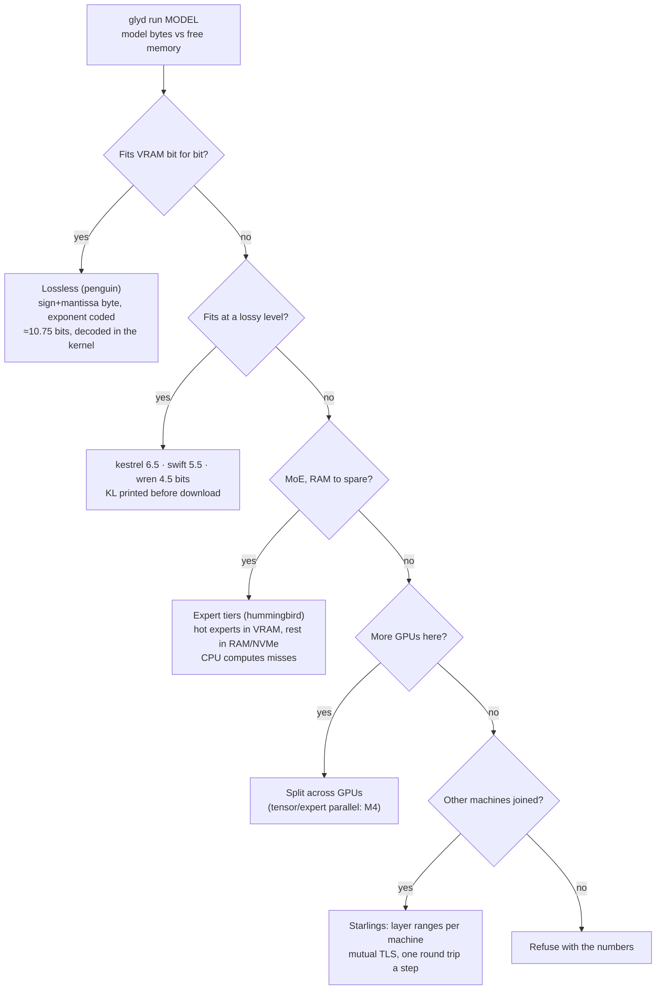
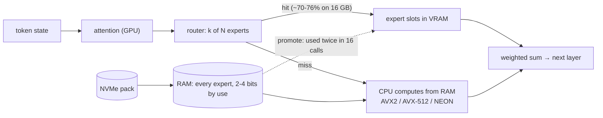
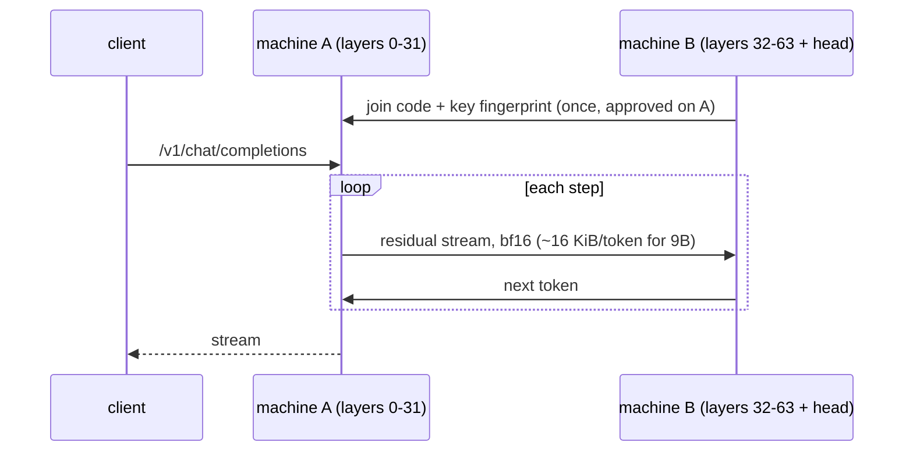

# Architecture

Glyd is an LLM inference engine in Rust. The goal is that you name a model and it decides everything else from the model,
the GPUs and the platform. This page keeps what exists apart from what is planned; the roadmap issue for each planned item
is named in brackets ([ROADMAP.md](../ROADMAP.md)).

## The contract

```
glyd run MODEL          # the goal: works on any supported machine, with no flags, or says in one line why not
```

What holds today:

- `glyd-engine fit MODEL` prints the plan (level, placement, context, predicted tokens/s) before any download.
  `glyd-engine run` and `serve` do not yet load by that plan (P2a).
- `glyd-engine run` refuses with one line and a fix where it cannot run a model (`machine.rs`, `support.rs`).
- Every choice can be overridden: `MODEL:level`, `--context`, `--split`, `--devices`, `--users`.
- At run time the engine needs only the GPU driver, which it opens itself (`glyd-engine/src/ffi.rs`); building it needs
  nvcc, or hipcc for AMD. The v0.33.0 `install.sh` installs the engine without Python; `glyd run` goes through the Python tool (vLLM) only where that tool is installed and the GPU is not one the engine is the default on.

What is planned:

- One `glyd` binary with the engine linked, no Python, no toolkit (P1). The AMD HIP runtime would ship in the backend bundle.
- Adapting at run time when other programs take GPU memory, instead of refusing at start. Today an out-of-memory load is
  refused with the numbers.
- Datacenter transports (NCCL, RCCL, NIXL) loaded when present. The engine uses none of them today.

## Adaptation

Model × hardware × platform → plan. The diagram is the design. `plan.rs` implements the decision order below; only the CUDA backend
(and HIP in development builds) exists behind it.

```
 probe                              describe                         decide                              run
 ─────                              ────────                         ──────                              ───
 OS, arch, CPU features (AVX2,      config.json / GGUF header:       backend   CUDA | ROCm | Metal | CPU   engine with
 AVX-512, AMX, NEON, SVE)           architecture, layer kinds,       format    lossless | lossy level      the plan;
 RAM, disks, free space             params / active params (MoE),    placement layers, experts, KV over:    re-plans on
 GPUs: vendor, arch, VRAM free,     release dtype (bf16, FP8, FP4,     VRAM → peer GPUs → host RAM →       memory pressure
   driver/runtime version,            GGUF quant), context, vision      NVMe → other machines
   P2P/NVLink, unified memory       cost profile: bytes per layer,   context, users, speculative decoding,
 other machines (cluster)             per token, per KV position     kernel variants per GPU
 measured rates (cached):                                            predicted tokens/s and quality (KL)
   memory, link, RAM, disk
```

Decision order (`glyd fit MODEL` prints every step; today `glyd-engine fit`):

1. **Backend**: the best available device vendor; CPU if none.
2. **Format**: the release's own format if it fits (bf16 → lossless pack; FP8/FP4 kept exactly); else the highest lossy
   level that fits at the minimum context (kestrel 6.5 → swift 5.5 → wren 4.5 → hummingbird ~2-3 bits on experts).
3. **Placement**: dense layers on the fastest tier that holds them, split across GPUs when one is not enough; MoE experts
   ranked by use, hot experts on the GPU, the rest in RAM (computed on the CPU) or on NVMe; layer ranges on other
   machines only when local tiers cannot hold the model.
4. **Context and users**: the KV cache takes what is left, sized for the asked context, else the largest that fits.
5. **Speed**: the cost profile against measured rates gives tokens/s; if below a floor, the next level down is offered.

The flowchart is the target. Today `fit` prints a plan like it, and `run` follows `support.rs`'s table, not the plan.



The ladder is the order of preference; the planner scores level and placement together and takes the best predicted
speed above a floor.

The pieces exist today: `glyd-engine/src/plan.rs` (the planner behind `glyd-engine fit`), `costs.rs` (cost profile and
rates), `machine.rs` and `preflight` (probe), `offload.rs` (expert cache), `dynamic/split.rs` (layer split), `starlings/`
(other machines). `run` and `serve` do not load by the plan yet, and `fit` can plan runs that `run` refuses: one
capability table shared by `fit`, `run` and refusals (P16) and loading by the plan (P2a) close that gap. Machines whose GPU
shares the computer's memory (Apple, DGX Spark, Jetson, Strix Halo) count that memory once.

## Runtime layers

The target; today most families have their own pipeline, and batching exists on the Qwen3 path only (M2 replaces them).

```
APIs            OpenAI (chat, completions, responses, embeddings) · Anthropic · Ollama · MCP · C ABI · Rust crate
Serving         one scheduler: continuous batching, paged KV, prefix cache, chunked prefill, preemption,
                speculative decoding, constrained decoding, multi-LoRA, sampling
Models          model = description + weight map over a library of layer kinds
                (attention: MHA/GQA/MLA/sliding/linear/delta; Mamba; dense MLP; MoE; vision encoders)
Planner         costs × rates × topology → placement and level
Backends        CUDA · ROCm/HIP · Metal (MLX) · CPU          Transports  P2P/NVLink · NCCL/RCCL · RDMA · TLS/TCP
Formats         glyd packs (lossless, lossy) · safetensors · GGUF · FP8/FP4/AWQ/GPTQ
```

Rules:

- A model is added as a description on the shared runtime, with a CPU f32 reference per layer kind and a logits test.
- A feature works for every model, or the server refuses it for that model with a one-line reason.
- A backend is added with the full model test suite passing on it.
- A speed change is merged with a `glyd bench` result; CI refuses regressions on the reference GPUs.

## Backends

The seam between vendors sits at the layer kind, not at alloc/launch: MLX and a CPU backend cannot implement CUDA's
memory-and-launch model, and candle, ggml and burn split the same way. Each backend implements the layer kinds it supports
and says which it does not; the scheduler drives a model step through a request-level engine interface. The sketch below
is superseded by the runtime design, [design/runtime.md](design/runtime.md) (R9), which names the traits (`ModelStep`, `Backend`,
`LayerImpl`) and the migration order:

```rust
pub trait Backend {
    fn devices(&self) -> Vec<DeviceInfo>;                          // vendor, arch, memory, links, unified or not
    fn supports(&self, kind: &LayerKind, format: Format) -> Support; // yes, no, or a slower path
    fn load(&self, weights: WeightView, placement: &Placement) -> Result<Loaded>;
    fn step(&self, model: &ModelStep, batch: &Batch) -> Result<Logits>; // graph-captured where the vendor allows
    fn collective(&self) -> Option<&dyn Collective>;               // all-reduce, all-gather, all-to-all
}
```

Within CUDA and HIP, one device layer (memory, streams, events, graphs, modules) sits under the kernels (R1a for CUDA in M2, R1b for HIP in M5b). Dispatch is
dynamic at the layer-kind boundary; nothing is generic over the backend engine-wide.

| Backend | Kernels | Libraries | State |
| :--- | :--- | :--- | :--- |
| CUDA | `glyd-engine/kernels/*.cu`, `gpu/glyd_gpu.cu` (mma.sync, cp.async; wgmma on H100/H200) | cuBLAS(Lt) when present; CUTLASS/FlashInfer (V8a, M2); NCCL planned (C2a, M4) | sm_80-sm_120, driver ≥ 535 (570 for Blackwell; a build with CUDA 13's kernels alone: 580), Linux x86_64; the default only on measured GPUs (S10) |
| ROCm/HIP | the same sources through `gpu/hip.h` (tensor ops emulated today); wave64 and MFMA paths for CDNA | hipBLASLt, aiter, composable_kernel (V8b, M5b); RCCL planned | RDNA 3/4 development builds (`GLYD_HIP=1`); CDNA to do (M5b) |
| Metal | MLX via `mlx-c` for dense ops; Glyd's formats as custom Metal kernels | MLX | To do (M5a) |
| CPU | AVX2, AVX-512, NEON (`cpu_*.rs`) | none | Experts only; whole models to do (M5a) |

The engine opens the driver at run time (`glyd-engine/src/ffi.rs`), but the vendor is a build-time choice today
(`cfg(glyd_hip)`). The release carries the engine's kernels twice, built with CUDA 13 (compressed) and CUDA 12.9 (not compressed, so that a driver of
CUDA 12.2 reads them), and no GPU library (a CUDA build loads none); the driver's version picks the kernels (`dev.rs`), and the release build adds the compute_89 PTX so
a GPU newer than the machine code still runs (P6). The target is a small core that downloads the signed kernel bundle for the machine's vendor (P7b).

## Build or reuse (split execution bottom)

Used today: `tokenizers`, `minijinja` (chat templates), `flate2`, `sha2`, `ureq`; the Hub client, safetensors reader and
JSON parser are Glyd's own. Planned (all Apache-2.0/MIT/BSD): `llguidance` (constrained decoding, R5a), `cudarc` for NCCL
(C2a), `mlx-c` (V3a), NIXL (after 1.0), and kernel libraries where they beat Glyd's own (`V8a` in M2: FlashInfer, CUTLASS,
Marlin, cuBLASLt — including datacenter Blackwell `sm_100` standard dense/FP8/NVFP4 GEMMs; `V8b` in M5b: hipBLASLt, aiter
and composable_kernel). Built here: the kernels for Glyd's compressed formats (one CUDA/HIP source tree, MLX custom Metal
kernels, Rust SIMD on CPU), 12-bit lossless KV attention, async MoE expert streaming, the KV block store and scheduler, the
SLO-aware planner, the GGUF reader (canonical quant kernels ported from ggml), and the API front ends.

The invariant across 8 GB cards to datacenter nodes is a **split execution bottom**: unify the binary, `ModelDesc`, scheduler,
memory/KV/expert-tier fabric and planner, while owning custom kernels only at the compression/offload boundary and delegating
compute-bound standard dense/FP8/NVFP4 ops to proven vendor libraries.

## Formats

| Format | Bits per weight | Lossless | Notes |
| :--- | ---: | :---: | :--- |
| penguin (`mma`, `mma12`) | ~10.75 / ~12.04 | yes | bf16 weights bit for bit; layout chosen per GPU |
| FP8 / FP4 / MXFP4 releases | as released | yes | kept as the release's codes; FP8 also in a ~7-bit lossless coding |
| kestrel / swift / wren | 6.5 / 5.5 / 4.5 | no | Int6 / Int5 / Int4; wren keeps QAT 4-bit releases exactly |
| hummingbird | ~2-3.4 on experts | no | experts' bits by use; attention 4-6 bits |
| KV cache | 12 (bf16 16) | yes | per-model tables; paged on the Qwen3 path today, every model in M2 |

`glyd verify` checks a lossless pack tensor by tensor against the source's sha256.

## MoE experts across tiers



GPU and CPU work on the same layer at once (`glyd-engine/src/offload.rs`). A draft head (MTP) proposes the next token
and the same pass checks it.

## Multi-GPU and multi-machine



- In one machine: layer split today (`--split`, `--devices`) for Nemotron-H, Kimi-K3, GLM-5.3-Flash, DeepSeek-V4 and Muse Spark at their lossless level, and not for Qwen3, Qwen3.5 or Gemma 4 (`support.rs`); tensor and expert parallel over P2P, NVLink or NCCL
  in M4 (RCCL in M5b).
- Across machines (`starlings/`): enrollment with fingerprints, mutual TLS over TCP, the engine's `rangeworker` per
  stage (`docs/range-worker.md`); RDMA transports for datacenters.
- One planner decides between them from measured link rates.

## Repository map

| Path | What |
| :--- | :--- |
| `glyd-engine/` | engine: `src/` (Rust), `kernels/` (CUDA/HIP), `docs/design/` |
| `gpu/` | GPU library (C API), vLLM plugin sources (`gpu/vllm/`, frozen) |
| `glyd-gpu/` | packer and verifier |
| `src/`, `glyd-store/` | codec and store |
| `starlings/` | cluster: own Cargo workspace, `rust-toolchain.toml` |
| `condor/` | MoE-on-one-GPU setup scripts, chat app, benchmarks |
| `bindings/`, `glyd-gpu-py/` | Python/Go bindings, Python GPU package (frozen) |
| `benchmarks/`, `research/` | measured results and research records |
