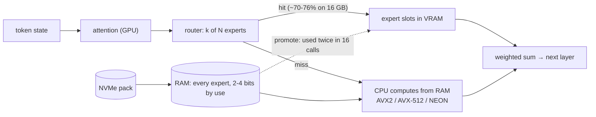
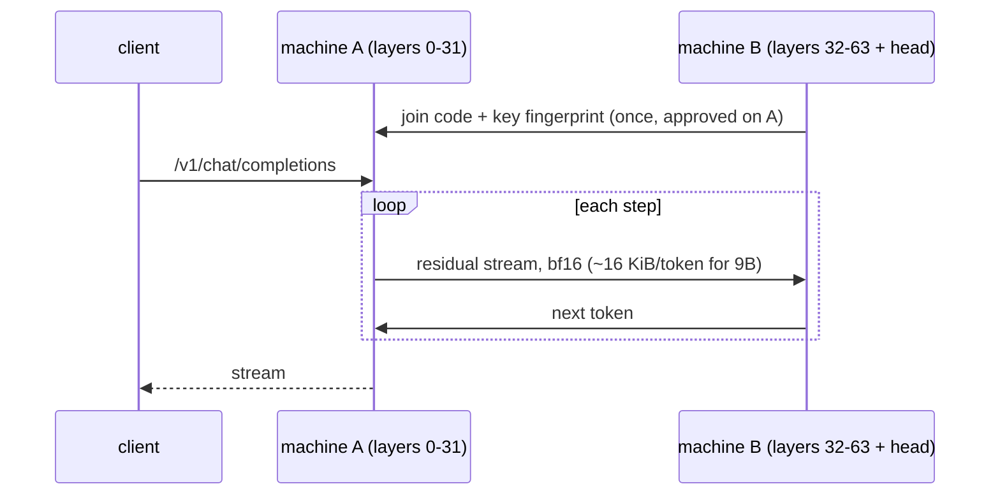

# Architecture

Glyd is one Rust program that runs open LLMs on whatever hardware it finds. The user names a model; Glyd decides
everything else from the model, the GPUs and the platform.

## The contract

```
glyd run MODEL          # works on any supported machine, with no flags, or says in one line why not
```

- No toolkit (CUDA, ROCm, Xcode), no Python, no environment. The GPU driver is the only dependency.
- Nothing irreversible before the plan: the decision (level, placement, context, expected tokens/s) is printed before
  any download.
- Never fail at start for lack of memory; adapt at run time when other programs take GPU memory.
- Every choice can be overridden (`MODEL:level`, `--context`, `--devices`, `--users`), none has to be.

## Adaptation

Model × hardware × platform → plan.

```
 probe                              describe                         decide                              run
 ─────                              ────────                         ──────                              ───
 OS, arch, CPU features (AVX2,      config.json / GGUF header:       backend   CUDA | ROCm | Metal | CPU   engine with
 AVX-512, AMX, NEON, SVE)           architecture, layer kinds,       format    lossless | lossy level      the plan;
 RAM, disks, free space             params / active params (MoE),    placement layers, experts, KV over:    re-plans on
 GPUs: vendor, arch, VRAM free,     release dtype (bf16, FP8, FP4,     VRAM → peer GPUs → host RAM →       memory pressure
   driver/runtime version,            GGUF quant), context, vision      NVMe → other machines
   P2P/NVLink, unified memory       cost profile: bytes per layer,   context, users, speculative decoding,
 other machines (cluster)             per token, per KV position     kernel variants per GPU
 measured rates (cached):                                            predicted tokens/s and quality (KL)
   memory, link, RAM, disk
```

Decision order (`glyd fit MODEL` prints every step):

1. **Backend**: the best available device vendor; CPU if none.
2. **Format**: the release's own format if it fits (bf16 → lossless pack; FP8/FP4 kept exactly); else the highest lossy
   level that fits at the minimum context (kestrel 6.5 → swift 5.5 → wren 4.5 → hummingbird ~2-3 bits on experts).
3. **Placement**: dense layers on the fastest tier that holds them, split across GPUs when one is not enough; MoE experts
   ranked by use, hot experts on the GPU, the rest in RAM (computed on the CPU) or on NVMe; layer ranges on other
   machines only when local tiers cannot hold the model.
4. **Context and users**: the KV cache takes what is left, sized for the asked context, else the largest that fits.
5. **Speed**: the cost profile against measured rates gives tokens/s; if below a floor, the next level down is offered.


The ladder is the order of preference; the planner scores level and placement together and takes the best predicted
speed above a floor.

The pieces exist today: `glyd-engine/src/costs.rs` (cost profile and rates), `machine.rs` and `preflight` (probe),
`offload.rs` (expert cache), `dynamic/split.rs` (layer split), `starlings/` (other machines). The work is to make them one
planner used by every model.

## Runtime layers

```
APIs            OpenAI (chat, completions, responses, embeddings) · Anthropic · Ollama · MCP · C ABI · Rust crate
Serving         one scheduler: continuous batching, paged KV, prefix cache, chunked prefill, preemption,
                speculative decoding, constrained decoding, multi-LoRA, sampling
Models          model = description + weight map over a library of layer kinds
                (attention: MHA/GQA/MLA/sliding/linear/delta; Mamba; dense MLP; MoE; vision encoders)
Planner         costs × rates × topology → placement and level
Backends        CUDA · ROCm/HIP · Metal (MLX) · CPU          Transports  P2P/NVLink · NCCL/RCCL · RDMA · TLS/TCP
Formats         glyd packs (lossless, lossy) · safetensors · GGUF · FP8/FP4/AWQ/GPTQ
```

Rules:

- A model is added as a description on the shared runtime, with a CPU f32 reference per layer kind and a logits test.
- A feature works for every model, or the server refuses it for that model with a one-line reason.
- A backend is added with the full model test suite passing on it.
- A speed change is merged with a `glyd bench` result; CI refuses regressions on the reference GPUs.

## Backends

```rust
pub trait Backend {
    fn devices(&self) -> Vec<DeviceInfo>;                 // vendor, arch, memory, links
    fn alloc(&self, dev: DeviceId, bytes: usize) -> Result<Buffer>;
    fn copy(&self, src: &Buffer, dst: &Buffer, stream: &Stream) -> Result<()>;
    fn launch(&self, k: &Kernel, grid: Grid, args: &Args, stream: &Stream) -> Result<()>;
    fn graph(&self, stream: &Stream) -> Result<Graph>;   // capture and replay (CUDA graphs, HIP graphs, Metal ICBs)
    fn collective(&self) -> Option<&dyn Collective>;      // all-reduce, all-gather, all-to-all
}
```

| Backend | Kernels | Libraries | State |
| :--- | :--- | :--- | :--- |
| CUDA | `glyd-engine/kernels/*.cu`, `gpu/glyd_gpu.cu` (mma.sync, cp.async, wgmma on Hopper) | cuBLAS(Lt) if present, NCCL | Production, sm_80-sm_120, driver ≥ 580 |
| ROCm/HIP | the same sources through `gpu/hip.h`; wave64 and MFMA paths for CDNA | hipBLASLt, RCCL | RDNA 3/4 builds (`GLYD_HIP=1`); CDNA to do |
| Metal | MLX via `mlx-c` for dense ops; Glyd's formats as custom Metal kernels | MLX | To do |
| CPU | AVX2, AVX-512, NEON (`cpu_*.rs`) | — | Experts only; whole models to do |

The engine opens drivers at run time (`glyd-engine/src/ffi.rs`); nothing vendor-specific is linked, so one binary per OS
and architecture carries every backend whose driver is present.

## Build or reuse

Reused (all Apache-2.0/MIT-compatible): `tokenizers`, `minijinja` (chat templates), `llguidance` (constrained decoding),
`safetensors`, `hf-hub`, `cudarc` (cuBLAS, NCCL), `mlx-c`, NCCL/RCCL, NIXL (datacenter KV transfer). Built here: the kernels
(one CUDA/HIP source tree, MLX custom Metal kernels, Rust SIMD on CPU), the KV block store and scheduler, the planner, the
GGUF reader (quant kernels ported from ggml), and the API front-ends.

## Formats

| Format | Bits per weight | Lossless | Notes |
| :--- | ---: | :---: | :--- |
| penguin (`mma`, `mma12`) | ~10.75 / ~12.04 | yes | bf16 weights bit for bit; layout chosen per GPU |
| FP8 / FP4 / MXFP4 releases | as released | yes | kept as the release's codes; FP8 also in a ~7-bit lossless coding |
| kestrel / swift / wren | 6.5 / 5.5 / 4.5 | no | Int6 / Int5 / Int4; wren keeps QAT 4-bit releases exactly |
| hummingbird | ~2-3.4 on experts | no | experts' bits by use; attention 4-6 bits |
| KV cache | 12 (bf16 16) | yes | paged, per-model tables |

`glyd verify` checks a lossless pack tensor by tensor against the source's sha256.

## MoE experts across tiers



GPU and CPU work on the same layer at once (`glyd-engine/src/offload.rs`). A draft head (MTP) proposes the next token
and the same pass checks it.

## Multi-GPU and multi-machine



- In one machine: layer split today (`--split`, `--devices`); tensor/expert parallel over P2P, NVLink or NCCL/RCCL.
- Across machines (`starlings/`): enrollment with fingerprints, mutual TLS over TCP, the engine's `rangeworker` per
  stage (`docs/range-worker.md`); RDMA transports for datacenters.
- One planner decides between them from measured link rates.

## Repository map

| Path | What |
| :--- | :--- |
| `glyd-engine/` | engine: `src/` (Rust), `kernels/` (CUDA/HIP), `docs/design/` |
| `gpu/` | GPU library (C API), vLLM plugin sources (`gpu/vllm/`, frozen) |
| `glyd-gpu/` | packer and verifier |
| `src/`, `glyd-store/` | codec and store |
| `starlings/` | cluster: own Cargo workspace, `rust-toolchain.toml` |
| `condor/` | MoE-on-one-GPU setup scripts, chat app, benchmarks |
| `bindings/`, `glyd-gpu-py/` | Python/Go bindings, Python GPU package (frozen) |
| `benchmarks/`, `research/` | measured results and research records |
