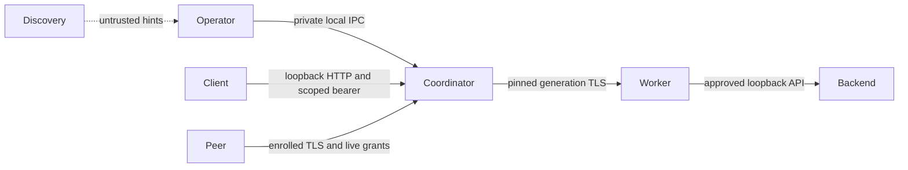

# Security boundaries and source threat model

This is the source threat model for [GLY-204](https://linear.app/getglyd/issue/GLY-204),
based on main935078fba7f05ad0e5812e6d8b22d8880eb5e740. It maps current entry points,
attacker capabilities, required invariants, source enforcement and remaining review
obligations. Scenarios are reasoning inputs, not executed attacks or findings.
This is not an independent audit, vulnerability
clearance, penetration-test result or release approval. Whole-request daemon
routing and layer-transport libraries have different deployment status.

## Assets and trusted actors

Protect coordinator signing keys, device keys, invitation/admin/client secrets,
membership and model permissions, prompts/outputs/state, verified model objects,
capacity reservations and cleanup ownership. Availability includes bounded
admission, freshness and conservative handling of ambiguous execution.

The operator controls the protected local profile and approves exact manifests,
routes and external executable/configuration digests. The coordinator is trusted
to grant authority; an enrolled worker is trusted with its assigned plaintext
inputs and execution. Enrollment authenticates a device, not correct arithmetic
or honest completion. There is no Byzantine-worker correctness guarantee.

Treat LAN senders, discovery announcements, HTTP requests, tensor metadata,
model/source files and provider responses as untrusted inputs until the specific
boundary checks them. A digest establishes byte identity, not publisher trust,
safe executable behavior, model license or truthful benchmark provenance.

An unauthenticated LAN sender can connect or advertise hints; an enrolled peer
can send validly authenticated but malformed/stale messages. A client can possess
a valid token without permission for another model/session. A different local
UID can attempt to substitute local endpoints/files. Sources, supplied evidence
and protocol replies can be malicious even when syntactically valid. Approved
native code, the profile-owning OS user/root, trusted local storage and the build
host/toolchain remain trust assumptions, not adversaries contained by an OS sandbox.
Failing trusted components still require conservative ownership and cleanup.
Loopback HTTP requires trust in the selected local service; it does not identify
the peer UID or confine other local users. The admin IPC peer checks are a separate
boundary, not a property inherited by HTTP clients or benchmark endpoints.

The diagram focuses on the runtime path; standalone CLI/build boundaries are
included in the table too. Library-only/planned surfaces are explicitly marked.

## Threat scenarios and review surfaces

| Surface / entry point | Scenario and required invariant | Existing enforcement to examine | Residual obligation |
| --- | --- | --- | --- |
| [Local admin](../crates/starlings-security/src/admin.rs), [daemon](../crates/starlings-cli/src/daemon.rs) | Another local UID substitutes an endpoint or repeats an ambiguous mutation; neither may gain authority or silently execute twice. | Private directory/file capability, challenge authentication, Unix peer UID or Windows local named-pipe ACL, bounded strict commands, exclusive profile owner. | Cross-user OS tests, ambiguous mutation outcomes and durable publication; no TCP admin or shell dispatch. Same-user/root compromise is outside this boundary. |
| [Enrollment](../crates/starlings-security/src/enrollment.rs), [renewal](../crates/starlings-security/src/renewal.rs) | A sender substitutes the authority or uses a copied device key; bootstrap must not disclose a secret before trust, and revocation must deny access. | Pinned authority before sending invitations, explicit fingerprint approval, expiring single-use invitation, current membership and immutable role/cluster. | Device-key lifetime/replacement, lost replies, revocation and restart/clock behavior. Certificate refresh is not device-key rotation. |
| [Admission](../crates/starlings-security/src/listener.rs), [registry](../crates/starlings-security/src/registry.rs), [transport](../crates/starlings-security/src/transport.rs) | Unauthenticated/revoked peers consume handshake work or reuse stale membership; one connection cannot substitute for live authorization. | Shared bounded pre-auth admission; proved registry slots; separate admin budget; TLS identity/CA/role/ALPN and current authorization; absolute record deadlines. | Fairness, freshness, reconnects, OS errors and final supported-platform qualification. Application bounds are not kernel flood protection or a hard CPU/RSS quota. |
| [Client HTTP](../crates/starlings-security/src/client.rs), [streaming](../crates/starlings-security/src/streaming.rs), [generation](../crates/starlings-security/src/generation.rs) | A browser origin or valid client token targets another model/session or holds output open; scope, quotas and withdrawal must still apply. | Literal loopback binding, exact Host, browser-origin rejection, bounded framing, scoped authorization before body/dispatch and each output enqueue. | Resource-to-scope binding, slow/disconnected clients, cancellation and revoked output. Bytes already enqueued to the kernel cannot be recalled. No remote/browser client support is implied. |
| [Catalog](../crates/starlings-security/src/catalog.rs), [cache](../crates/starlings-security/src/catalog/cache.rs) | A hostile source replaces/truncates bytes or escapes paths; matching a supplied digest must not confer publisher/parser trust. | Capability paths, strict manifests, explicit approval, exact lengths/hashes, protected atomic objects, quotas, durable pins; explicit allowlisted HTTPS fetch with bounded redirects. | Source/license/tensor completeness, hostile model parsers, disk faults and native lifetime integration. Registration/hash readiness is not inference approval; GC cannot substitute for drain. |
| [External service](../crates/starlings-adapters/src/service.rs), [routing](production-routing.md), [recovery](service-recovery.md) | A wrong/failing backend reports readiness/cleanup or leaves uncertain work; receipts/process exit must not free an unproven native owner. | Explicit executable/configuration/model/profile approval, no shell/PATH lookup, cleared inherited environment, fresh local API key, bounded no-redirect HTTP, one owned request and retained quarantine. | Installed provider GLY-238 identity/tokenizer/memory/cancel/drain/recovery conformance. The child runs as the local OS user; process ownership is not an OS sandbox. Approved native code remains trusted. |
| [Stage grants](../crates/starlings-security/src/authorization/stage.rs), [framing](../crates/starlings-security/src/data.rs), [flow](../crates/starlings-security/src/data/flow.rs) | An enrolled peer replays/reorders/oversizes tensors or treats receipt as execution; it must not mutate a generation twice or release uncertain buffers. | Exact owner/plan/lease/epoch/peer/direction, live grants, shape/length limits before allocation, credit and bounded reassembly, ordering, poisoned failed connections and retained in-flight ownership. | Deployed native partial loading, post-handoff state/cleanup and physical-link evidence require GLY-235/236. Libraries/receipts do not qualify native execution or safe device completion. |
| [Discovery](discovery.md), [network policy](../crates/starlings-security/src/network.rs) | A spoofed hint redirects an operator or exposes topology; discovery must not grant trust, model permission or execution. | Explicit allowed local routes; opt-in mDNS contains public hints only; discovery cannot enroll, approve a model or activate a route. | Spoofed/obsolete hints and topology privacy; no automatic firewall/router/NAT changes or Internet exposure. |
| [Diagnostics](diagnostics.md), [benchmark inspection](benchmark-inspection.md), [packaging](packaging.md) | Forged evidence/support output leaks data or is mistaken for native qualification; integrity and redaction are narrower than truth or approval. | Bounded redacted observations, offline supplied artifacts, explicit fixture status, checksummed private candidate artifacts and inactive descriptors. | Raw-evidence review, complete SBOM/license/model inventory, provenance and installed lifecycle; no automatic upload, attestation or release authorization. |
| [Link diagnostics](../crates/starlings-cli/src/links.rs), [probe protocol](../crates/starlings-security/src/probes.rs), [token profile](../crates/starlings-security/src/probes/token.rs), [private export](../crates/starlings-cli/src/link_record.rs) | A worker spends diagnostic bandwidth or reuses stale statistics; link probing must not amplify retries or confer inference permission. | Exact approved limits, separate ALPN, enrolled worker/coordinator and live fences; legacy5s/1MiB/8pings unchanged. Opt-in profile extends only after authenticated matching Hello and old setup deadline checks:30s absolute body/attempt cap,2MiB,100exchanges,2000wakes,4KiB buffer, cooldown charged on failure. Partial/stale diagnostics remain non-admitting; export makes one read-only call/new private file. | Application caps are not network-wide protection. Diagnostic TTL/history, raw records and code fingerprints are not security attestations, native readiness, physical-link/power results or placement authority; GLY-175/184/241. |
| [Benchmark collector](../crates/starlings-cli/src/collector.rs) | A selected endpoint receives a credential, stalls or fabricates usage; collection must remain within explicit endpoints/budgets and preserve failures. | Literal loopback endpoints, proxy disabled, redirects refused, fixed credential environment names, bounded requests/replies/deadlines, checked usage and new output files. | The selected service is trusted with its bearer credential. Protect the evidence directory; hashes/usage do not prove honesty or native drain. Collection owns no service lifecycle and starts no backend; GLY-194/245/196. |
| [Native observations](../crates/starlings-adapters/src/resources.rs), [NVIDIA library](../crates/starlings-adapters/src/resources/nvidia.rs) | An explicitly selected library/dependency executes native code or reports misleading pools; identity must not become sandbox or model-support proof. | Explicit current CLI path, absolute/canonical primary-library selection and content approval before loading, bounded device inventory and conservative unavailable/shared-pool handling. | Driver/library dependencies and loader environment remain trusted; approval of one file does not attest them or hard-bound a native call. No implicit heartbeat query or execution qualification; GLY-173/175/204. |
| [Offline planning](../crates/starlings-cli/src/planning.rs), [preview](partition-preview.md), [mode costs](mode-costs.md) | Supplied costs understate memory or an advisory result is treated as authority; a valid prediction must never grant execution or cleanup. | Bounded strict file input, checked costs/identity/freshness/pool arithmetic and fixture policy; reports remain advisory with admission false. | Supplied declarations are not measured allocations. Actual all-stage readiness/commit/native ownership and calibration remain GLY-181/235/236; missing evidence cannot be replaced by a preview. |
| [Candidate build](../scripts/build-candidate.sh), [descriptor export](../crates/starlings-cli/src/service_template.rs) | Build code emits a malicious binary/private receipt, or paths are reinterpreted as commands; source identity/rendering must not become safe execution or installation proof. | Locked/offline pinned compiler invocation, fixed candidate members/checksums, new output paths; bounded canonical private descriptor paths and native argument escaping, no service-manager activation. | The build host/toolchain/macros/scripts and approved native dependencies are trusted code. Raw receipts may contain private metadata; descriptors do not pin future mutable config/binary contents. Provenance/notices/OS lifecycle and approval remain GLY-198/204/205/206. |

## Model scope and change triggers

The table covers current runtime listeners, callable transport libraries and
standalone CLI/build tools. It models the proposed native boundary as unknown
owned code/protocol: no installed partial-worker implementation is audited here.
GLY-235/236/238 delivery and [Apple feasibility](apple-backend-feasibility.md)
must supply actual identity, allocation, state and completion semantics before
native integration can qualify. Trusted workers/native code can still be wrong;
there is no Byzantine computation or same-user sandbox guarantee.

Refresh this model when a listener/ALPN, authorization/lifetime rule, artifact
provider/parser, native library/backend, diagnostic export, permission or
packaging/activation path changes. Source modeling does not complete the separate
GLY-204 control-verification, SBOM/license or independent-review obligations.
Native cleanup/profile validation belongs to GLY-172/176/181/186/187; physical
fault/load/OS evidence to GLY-184/195/198; final review/disposition/publication to
GLY-204/205/206. An unresolved critical finding blocks release in its owning issue.

## Failure and release obligations

Recheck live authorization and freshness at the action/output boundary; connection
authentication alone is insufficient. A receipt is not native completion. After
possible model-state mutation, terminate the generation on ambiguity instead of
replaying a token or silently resuming KV state. Withdrawal stops output, while
reservations/pins remain until trusted cleanup. A timeout or empty process list
does not independently prove native drain. Follow the explicit recovery contract.

Review local-file ownership, symlink/reparse containment and crash publication on
each supported OS. Trusted local storage, OS permissions and uncompromised local
privileged users are assumptions; network filesystems/power-cut durability are not
certified. Copied device credentials require actual revocation/key-lifetime policy.

Release remains gated on:

- Independent review of these entry points and findings; critical unresolved
  findings must block release with rationale and a named owning issue.
- Existing lockfile/advisory/license policy plus the actual distributable SBOM,
  executable/dependency/model/provenance inventory; no private/Exo source or secrets.
- Supported-platform authorization/redaction/key/revocation/recovery regressions,
  approved parser instrumentation and native/service/device evidence. Existing CI
  is evidence for its selected software cases, not all operational guarantees.
- GLY-205 license/distribution decision and GLY-206 final inventory/publication
  approval. The project license remains undecided; candidates remain unpublished.

The current local preparation uses file reading/link validation only. It executes
no listener, service, scan, traffic generation, attack simulation, host/security
instrumentation or model workload and changes no security controls. Further test
campaigns need their separately approved environment and bounds.
